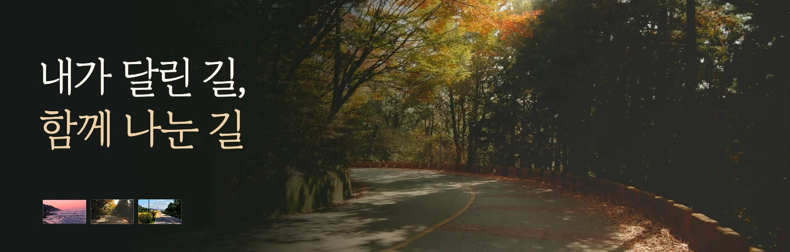
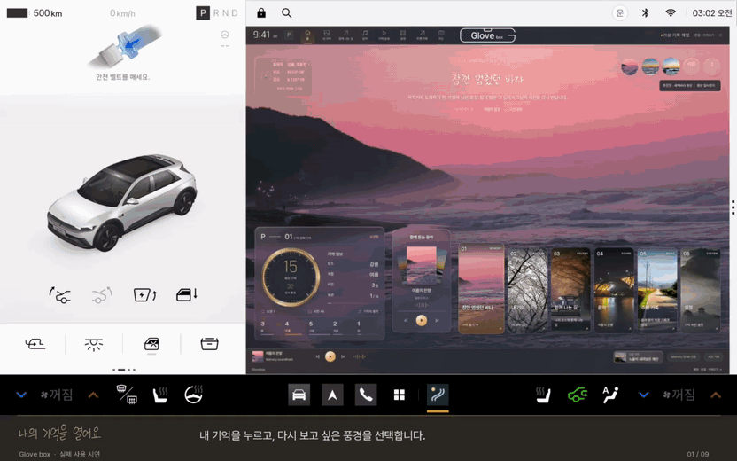
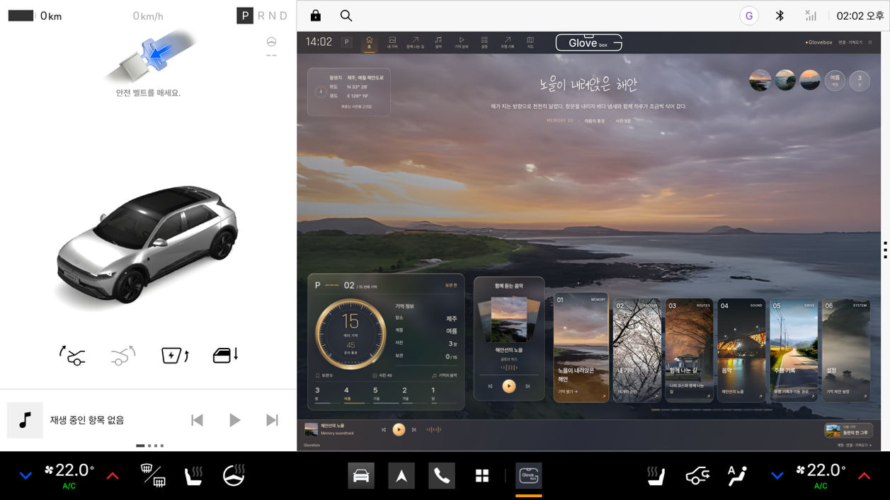
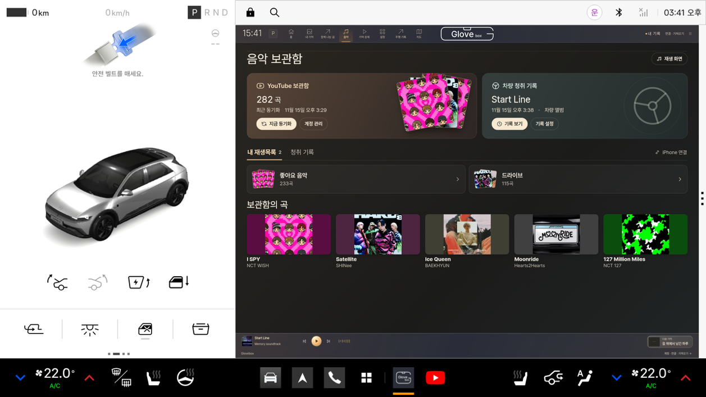
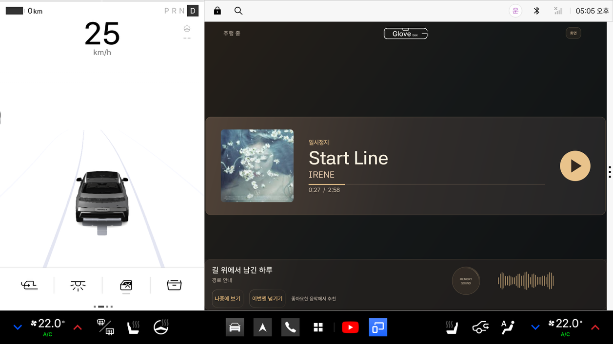

#  Glovebox

**모빌리티 환경에서 추억이 담긴 곳을 다시 찾고, 사진과 음악으로 남긴 드라이브 코스를 다른 운전자와 공유하는 인포테인먼트 플랫폼**



## 기획 의도

자동차는 추억이 담긴 장소로 우리를 직접 데려다줄 수 있습니다. 휴대폰에 남겨 둔 사진을 다시 찾아보는 일은 드물어도, 운전하다가 예전에 다녀온 곳을 우연히 지나는 일은 있습니다. 저희는 그곳을 다시 지나는 순간에 당시 찍은 사진과 들었던 음악을 차에서 찾아볼 수 있으면 좋겠다고 생각했습니다.

Glovebox라는 이름은 운전자와 동승자가 함께 열어 보는 차 안의 글로브박스에서 따왔습니다. 내가 달린 길도 다른 운전자와 나눌 수 있도록, 경유지마다 사진과 음악, 메모를 담아 하나의 코스로 공유합니다. 코스를 열어 본 사람은 어느 길을 따라갔는지, 어디에 차를 세웠는지 살펴보고 다음 드라이브를 계획할 수 있습니다.



## 홈과 방문 앨범

홈을 열면 지난 방문에서 찍은 사진이 배경에 보입니다. 방문 장소와 날짜를 확인하고, 옆에 있는 음악 카드에서 앨범에 담긴 곡을 바로 재생할 수 있습니다.



휴대폰 사진은 촬영 위치와 시간을 기준으로 묶습니다. 같은 장소라도 다녀온 날이 다르면 앨범이 따로 생깁니다. 차가 예전에 사진을 찍었던 장소에 가까워지면 당시 방문을 알려줍니다.

## 사진과 추천곡

사진을 찍은 시각과 청취 기록을 대조해 방문 당시 들었던 곡을 먼저 추천합니다. 당시 기록이 없으면 장소와 사진 속 풍경, 계절을 바탕으로 내 YouTube 보관함에서 곡을 고릅니다. 앨범에서는 그 곡을 추천한 이유도 확인할 수 있습니다.

주차 중에 곡을 선택하면 사진 한쪽에 YouTube 플레이어가 열립니다. 듣고 싶은 구간으로 이동하거나, 음악을 들으면서 화살표와 미리보기로 사진을 넘길 수 있습니다.


## 음악 보관함과 주행 모드

| 음악 보관함 | 주행 중 재생 |
| --- | --- |
| [](docs/images/music-library.webp) | [](docs/images/drive-player.webp) |
| 내 YouTube 계정에서 좋아요를 누른 곡과 재생목록을 불러옵니다. 마지막 동기화 후 6시간이 지나면 다음 주차 때 목록을 갱신합니다. 청취 기록을 켜면 주행 중 들은 곡도 경로와 함께 남습니다. | 차가 출발하면 영상이 닫히고 음악 제어 화면이 열립니다. 연결된 iPhone의 YouTube Music에서 듣던 곡을 차량 화면에서 일시정지하거나 이어 들을 수 있습니다. 다시 주차하면 보던 사진으로 돌아갑니다. |

## 내가 달린 길

출발부터 주차할 때까지 실제로 달린 길을 지도에 기록합니다. 주행을 마치면 이동 거리와 소요 시간을 확인할 수 있습니다. 지도에는 이번에 찍은 사진과 예전에 같은 길에서 찍은 사진이 함께 표시됩니다. 사진을 누르면 그날의 방문 앨범이 열립니다.


## 함께 나눈 길

공유 지도에서 운전자의 프로필을 누르면 그 사람이 공유한 드라이브 코스를 볼 수 있습니다. 코스를 열면 실제로 달린 경로와 방문 순서가 지도에 표시되고, 각 경유지를 누르면 작성자가 남긴 사진과 메모를 볼 수 있습니다.

마음에 드는 코스는 보관함에 저장할 수 있습니다. **코스 보내기**를 선택하면 작성자와 경유지 정보가 담긴 파일을 공유합니다. 받은 사람도 Glovebox에서 같은 경로를 열어볼 수 있습니다.


## 설치와 실행

[GitHub Release](https://github.com/Glanceyes/Glovebox_Pleos/releases/tag/v0.31.12) · [제출용 APK 다운로드](https://github.com/Glanceyes/Glovebox_Pleos/releases/download/v0.31.12/Glovebox_Glovebox_release.apk)

1. Pleos Connect 에뮬레이터를 실행하고 다운로드한 APK를 설치합니다.
   ```sh
   adb install -r Glovebox_Glovebox_release.apk
   ```
2. 차량의 앱 목록에서 **Glovebox**를 엽니다. 첫 실행부터 방문 앨범, 주행 기록과 공유 코스를 살펴볼 수 있습니다.
3. 개인 음악 추천을 사용하려면 주차 화면에서 휴대폰으로 QR을 스캔해 본인의 YouTube 계정을 연결합니다. YouTube 음악 재생과 보관함 동기화에는 인터넷 연결이 필요합니다.

| 테스트 환경 | 사용 버전 |
| --- | --- |
| Pleos Connect | v2.1.0 · Android 14 (API 34), arm64-v8a |
| Android Emulator | 37.2.13.0 |
| 차량 디스플레이 | 2560 × 1440, 가로, 160 dpi |
| Glovebox | 0.31.12 (51) |

## 개발 및 빌드

팀 인계본의 `Glovebox-Pleos.apk`를 기준으로 빌드합니다. [빌드 방법](빌드방법.md)

<details>
<summary>소스 구성</summary>

| 경로 | 내용 |
| --- | --- |
| [native-java/](native-java/) | 방문 앨범, 계정별 음악 추천, 차량·휴대폰 미디어 제어 |
| [web-runtime/](web-runtime/) | 홈, 음악 보관함, 주행 지도, 운전자 프로필과 공유 코스 화면 |
| [integration/](integration/) | Android 패치, 런처 아이콘, Pleos 에뮬레이터용 iPhone 연동 |
| [apk-patches/](apk-patches/) · [scripts-reference/](scripts-reference/) | 동료 작업본의 패치 내역과 초기 빌드 스크립트 |

공모전 시연 앨범을 빌드에 포함하려면 팀 보관 파일 `Glovebox_통합_수정소스.zip`의 `Glovebox/native-assets/recording/`을 저장소의 `native-assets/recording/`에 복사합니다.

</details>
