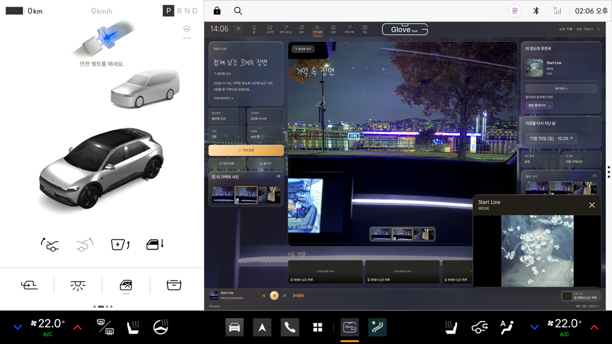
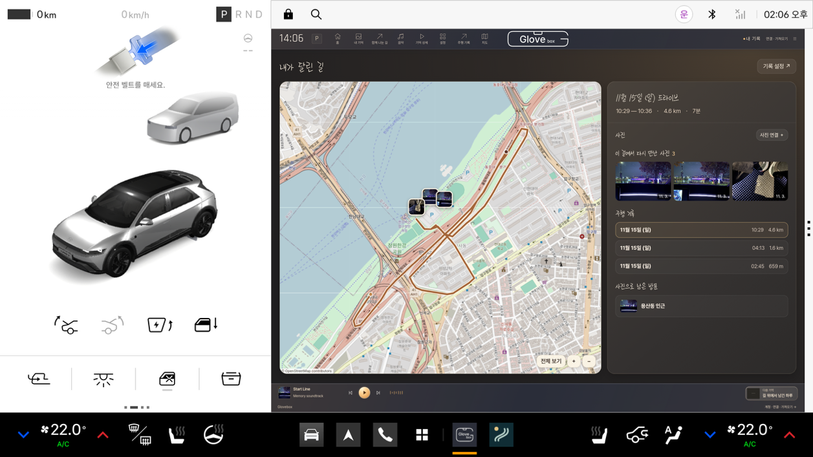
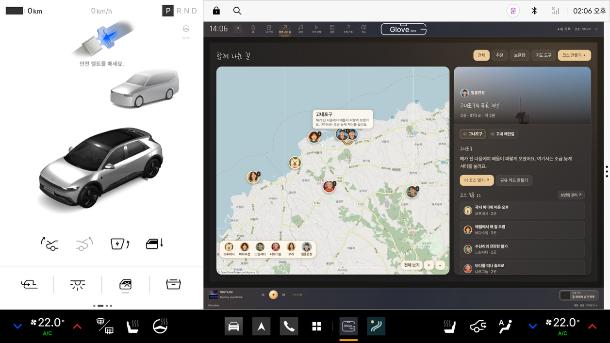

# Glovebox

**모빌리티 환경에서 추억이 담긴 장소를 다시 찾고, 사진과 음악으로 기록한 드라이브 코스를 다른 운전자와 공유하는 인포테인먼트 플랫폼**


자동차는 추억이 담긴 장소로 우리를 직접 데려다줄 수 있습니다. Glovebox는 예전에 방문한 곳에 차가 가까워지면 그곳에서 찍은 사진과 들었던 음악을 찾아줍니다.

## 방문 앨범과 추천곡

휴대폰 사진을 촬영 위치와 시간에 따라 방문별로 묶습니다. 앨범에는 방문 당시 들었던 곡을 우선 연결합니다. 청취 기록이 없으면 장소와 사진 속 풍경, 계절을 바탕으로 사용자의 YouTube 보관함에서 어울리는 곡을 추천합니다. 주차 중에는 앨범에서 음악을 들으며 사진을 넘겨볼 수 있습니다.



## 음악 보관함과 주행 모드

| 음악 보관함 | 주행 중 재생 |
| --- | --- |
| [](docs/images/music-library.webp) | [](docs/images/drive-player.webp) |
| 내 YouTube 계정의 좋아요와 재생목록을 불러옵니다. 청취 기록을 켜면 차량에서 들은 곡과 시각을 확인할 수 있습니다. | 출발하면 앨범에서 음악 제어 화면으로 전환합니다. 연결된 iPhone에서 듣던 곡을 차량 화면에서 일시정지하거나 이어 들을 수 있습니다. |

## 내가 달린 길

주행을 마치면 지도에서 이동 경로와 거리, 소요 시간을 확인할 수 있습니다. 경로에는 주행 중 찍은 사진과 이전에 같은 장소에서 찍은 사진이 함께 표시됩니다. 사진을 선택하면 해당 방문의 앨범이 열립니다.



## 함께 나눈 길

주행 경로에 경유지별 사진과 음악, 메모를 담아 드라이브 코스를 공유합니다. 지도에서 다른 운전자의 프로필을 선택하면 그 사람이 공유한 코스와 방문 순서를 볼 수 있습니다. 마음에 드는 코스는 보관함에 저장하거나 다른 사람에게 보낼 수 있습니다.



## 설치와 실행

[GitHub Release](https://github.com/Glanceyes/Glovebox_Pleos/releases/tag/v0.31.12) · [제출용 APK 다운로드](https://github.com/Glanceyes/Glovebox_Pleos/releases/download/v0.31.12/Glovebox_Glovebox_release.apk)

1. Pleos Connect 에뮬레이터를 실행하고 다운로드한 APK를 설치합니다.
   ```sh
   adb install -r Glovebox_Glovebox_release.apk
   ```
2. 차량의 앱 목록에서 **Glovebox**를 엽니다. 첫 실행부터 방문 앨범, 주행 기록과 공유 코스를 살펴볼 수 있습니다.
3. 개인 음악 추천을 사용하려면 주차 화면에서 휴대폰으로 QR을 스캔해 본인의 YouTube 계정을 연결합니다. YouTube 음악 재생과 보관함 동기화에는 인터넷 연결이 필요합니다.

| 테스트 환경 | 사용 버전 |
| --- | --- |
| Pleos Connect | v2.1.0 · Android 14 (API 34), arm64-v8a |
| Android Emulator | 37.2.13.0 |
| 차량 디스플레이 | 2560 × 1440, 가로, 160 dpi |
| Glovebox | 0.31.12 (51) |

## 개발 및 빌드

팀 인계본의 `Glovebox-Pleos.apk`를 기준으로 빌드합니다. [빌드 방법](빌드방법.md)

<details>
<summary>소스 구성</summary>

| 경로 | 내용 |
| --- | --- |
| [native-java/](native-java/) | 방문 앨범, 계정별 음악 추천, 차량·휴대폰 미디어 제어 |
| [web-runtime/](web-runtime/) | 홈, 음악 보관함, 주행 지도, 운전자 프로필과 공유 코스 화면 |
| [integration/](integration/) | Android 패치, 런처 아이콘, Pleos 에뮬레이터용 iPhone 연동 |
| [apk-patches/](apk-patches/) · [scripts-reference/](scripts-reference/) | 동료 작업본의 패치 내역과 초기 빌드 스크립트 |

공모전 시연 앨범을 빌드에 포함하려면 팀 보관 파일 `Glovebox_통합_수정소스.zip`의 `Glovebox/native-assets/recording/`을 저장소의 `native-assets/recording/`에 복사합니다.

</details>
